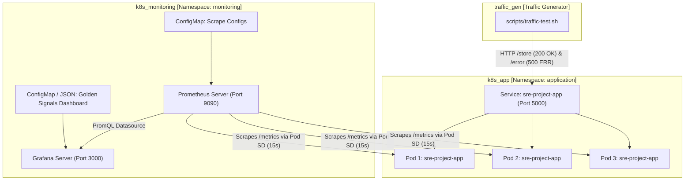

# 🚀 SRE Infrastructure as Code & Observability Platform

An end-to-end Site Reliability Engineering (SRE) project demonstrating **Infrastructure as Code (IaC)**, **Microservices Metric Instrumentation**, and **Cloud-Native Observability**. This project provisions a resilient multi-namespace Kubernetes environment on Minikube using Terraform, deploys an instrumented Python Flask microservice, and configures an observability stack featuring **Prometheus** and **Grafana** with automated Golden Signals dashboards and alerting rules.

---

## 📑 Table of Contents

- [Architecture Overview](#-architecture-overview)
- [Repository Structure](#-repository-structure)
- [Component Breakdown](#-component-breakdown)
  - [1. Infrastructure Layer (Terraform & Kubernetes)](#1-infrastructure-layer-terraform--kubernetes)
  - [2. Observability & Monitoring Stack](#2-observability--monitoring-stack)
  - [3. Application Layer](#3-application-layer)
  - [4. Traffic Simulation & Chaos Testing](#4-traffic-simulation--chaos-testing)
- [SRE Principles & The Four Golden Signals](#-sre-principles--the-four-golden-signals)
- [Prerequisites](#-prerequisites)
- [Deployment Guide](#-deployment-guide)
  - [Step 1: Start Kubernetes Cluster](#step-1-start-kubernetes-cluster)
  - [Step 2: Deploy Infrastructure via Terraform](#step-2-deploy-infrastructure-via-terraform)
  - [Step 3: Deploy Application Microservice](#step-3-deploy-application-microservice)
  - [Step 4: Provision Grafana Dashboard & Scrape Configs](#step-4-provision-grafana-dashboard--scrape-configs)
- [Operational Runbook & Access](#-operational-runbook--access)
  - [Accessing Grafana](#accessing-grafana)
  - [Accessing Prometheus](#accessing-prometheus)
  - [Accessing Alertmanager](#accessing-alertmanager)
  - [Accessing Application & Metrics](#accessing-application--metrics)
- [Generating Traffic & Simulating Incidents](#-generating-traffic--simulating-incidents)
- [SRE Evaluation & Evidence Checklist (Screenshots)](#-sre-evaluation--evidence-checklist-screenshots)
- [Troubleshooting & Verification Commands](#-troubleshooting--verification-commands)

---

## 🏛 Architecture Overview

<p align="center">
  
</p>

### System Topology & Metric Flow



---

## 📂 Repository Structure

```text
.
├── Docs/
│   └── README.md                       # Initial environment setup notes & provider reference
├── scripts/
│   └── traffic-test.sh                 # Automated load and HTTP 500 error chaos generator
├── Terraform/
│   ├── App/
│   │   ├── app.py                      # Flask REST API instrumented with prometheus-flask-exporter
│   │   ├── Dockerfile                  # Non-root, multi-stage Python 3.13-slim container
│   │   ├── requirements.txt            # Application dependencies (Flask, Gunicorn, Prometheus exporter)
│   │   ├── deployment.yaml             # Kubernetes Deployment (3 replicas) and ClusterIP Service
│   │   └── README.md                   # Application documentation
│   └── stack/
│       ├── required_providers.tf       # Terraform provider definitions (Kubernetes & Helm)
│       ├── namespaces.tf               # Isolated namespaces: 'application', 'monitoring', 'metrics'
│       ├── prometheus.tf               # Prometheus Helm release with custom Pod SD relabeling
│       ├── grafana.tf                  # Grafana Helm release deployed into monitoring namespace
│       ├── Configmaps/
│       │   ├── dashboard-golden-signals.json   # Grafana Golden Signals Dashboard definition
│       │   ├── prometheus-config.yaml          # Standalone Prometheus server configuration
│       │   └── configmap-prometheus-server.yaml# Prometheus ConfigMap backup & reference
│       └── README.md                   # Stack documentation
├── notes.txt                           # Handy operational commands and credential extraction snippets
└── README.md                           # Master SRE Project Documentation
```

---

## 🔍 Component Breakdown

### 1. Infrastructure Layer (Terraform & Kubernetes)
- **`Terraform/stack/required_providers.tf`**: Configures the HashiCorp `kubernetes` (v3.5.0+) and `helm` (v3.3.0+) providers targeting the local Minikube cluster via `~/.kube/config`.
- **`Terraform/stack/namespaces.tf`**: Segregates concerns into dedicated namespaces:
  - `application`: Houses the business microservice and service endpoints.
  - `monitoring`: Contains Prometheus Server, Alertmanager, and Grafana.

### 2. Observability & Monitoring Stack
- **`Terraform/stack/prometheus.tf`**:
  - Deploys Prometheus via the official Helm chart (`prometheus-community/prometheus`).
  - Configures an `extraScrapeConfigs` job (`sre-project-app`) that leverages **Kubernetes Pod Service Discovery** (`kubernetes_sd_configs`), dynamically discovering all pods matching label `app: sre-project-app` running in the `application` namespace and scraping them every 15s at `/metrics`.
- **`Terraform/stack/grafana.tf`**:
  - Deploys Grafana via Helm (`grafana/grafana`) into the `monitoring` namespace.
- **`Terraform/stack/Configmaps/dashboard-golden-signals.json`**:
  - Provisions the **Golden Signals Dashboard** in Grafana with custom panels:
    - **Traffic**: Request rate in requests per second (`reqps`) across the Flask endpoints.
    - **Latency**: Average HTTP request latency calculated via duration sum and count histograms.
    - **Errors**: Real-time percentage of HTTP 5xx errors vs. total incoming requests.
    - **Saturation**: CPU usage and container memory working set bytes across application pods.

### 3. Application Layer
- **`Terraform/App/app.py`**:
  - Lightweight Flask microservice.
  - Endpoints:
    - `GET /`: Root health check (`Hello, World!`).
    - `GET /store`: Product catalog retrieval endpoint (simulates regular 200 OK traffic).
    - `GET /error`: Fault simulation endpoint (returns HTTP 500 `Simulated server error` for error-rate testing).
    - `GET /metrics`: Standard Prometheus metrics endpoint automatically instrumented via `PrometheusMetrics(app)`.
- **`Terraform/App/Dockerfile`**:
  - Built on `python:3.13-slim` with a dedicated non-root user (`appuser`) for container security best practices.
  - Served via production-grade WSGI server `gunicorn` on port 5000.
- **`Terraform/App/deployment.yaml`**:
  - Kubernetes Deployment managing **3 replicas** for high availability and load distribution.
  - Exposes port 5000 via a ClusterIP service named `sre-project-app`.

### 4. Traffic Simulation & Chaos Testing
- **`scripts/traffic-test.sh`**:
  - An automated SRE load generation tool.
  - In each iteration:
    - Sends 20 continuous requests to `/store` (generating baseline traffic & latency telemetry).
    - Injects a randomized burst of 1–10 requests to `/error` (generating HTTP 500 fault spikes).
    - Pauses for 5 seconds and repeats indefinitely to populate Prometheus timeseries data and Grafana panels.

---

## 📊 SRE Principles & The Four Golden Signals

This architecture is built around Google SRE's **Four Golden Signals**:

| Golden Signal | Metric / Source | PromQL Query | Observability Goal |
| :--- | :--- | :--- | :--- |
| **Traffic** | Flask HTTP Request Total | `sum(rate(flask_http_request_total{job="sre-project-app"}[5m]))` | Measure throughput and demand on the microservice in requests per second. |
| **Latency** | Flask Request Duration Histogram | `sum(rate(flask_http_request_duration_seconds_sum{job="sre-project-app"}[5m])) / sum(rate(flask_http_request_duration_seconds_count{job="sre-project-app"}[5m]))` | Track average response time across endpoints to protect SLA/SLO thresholds. |
| **Errors** | HTTP 5xx Status Rates | `100 * sum(rate(flask_http_request_total{job="sre-project-app",status=~"5.."}[5m])) / sum(rate(flask_http_request_total{job="sre-project-app"}[5m]))` | Calculate real-time error percentage and monitor error budget consumption. |
| **Saturation** | Container CPU & Memory | `sum(rate(container_cpu_usage_seconds_total{namespace="application",pod=~"sre-project-app-.*"}[5m]))`<br>`container_memory_working_set_bytes{namespace="application",pod=~"sre-project-app-.*"}` | Identify resource constraints on CPU and Memory before performance degrades. |

---

## ⚙️ Prerequisites

Before launching the project, ensure you have the following installed on your host:

- [Minikube](https://minikube.sigs.k8s.io/docs/start/) (`v1.30+`)
- [kubectl](https://kubernetes.io/docs/tasks/tools/) (`v1.28+`)
- [Terraform](https://developer.hashicorp.com/terraform/downloads) (`v1.5.0+`)
- [Helm](https://helm.sh/docs/intro/install/) (`v3.10+`)
- [curl](https://curl.se/) and [bash](https://www.gnu.org/software/bash/) (for load testing)

---

## 🚀 Deployment Guide

### Step 1: Start Kubernetes Cluster
```bash
# Start Minikube with sufficient resources for the observability stack
minikube start --cpus=4 --memory=8192 --driver=docker

# Verify connection
kubectl cluster-info
```

### Step 2: Deploy Infrastructure via Terraform
```bash
cd Terraform/stack

# (Optional) Configure Email Notifications for Alertmanager
cp terraform.tfvars.example terraform.tfvars
# Edit terraform.tfvars with your email and SMTP / App Password

# Initialize Terraform providers (Kubernetes & Helm)
terraform init

# Validate configuration
terraform validate

# Plan the infrastructure execution
terraform plan

# Apply the stack (creates namespaces, Prometheus, Grafana)
terraform apply -auto-approve
```

### Step 3: Deploy Application Microservice
```bash
# Deploy the Flask application (3 replicas) and ClusterIP service
kubectl apply -f ../App/deployment.yaml

# Verify all pods are in Running state
kubectl get pods -n application
kubectl get svc -n application
```

### Step 4: Provision Grafana Dashboard & Scrape Configs
```bash
# Apply Prometheus Server ConfigMap
kubectl apply -f Configmaps/prometheus-config.yaml
```

---

## 🛠 Operational Runbook & Access

### Accessing Grafana
1. **Retrieve the auto-generated admin password**:
   ```bash
   kubectl get secret --namespace monitoring grafana -o jsonpath="{.data.admin-password}" | base64 --decode ; echo
   ```
2. **Port-forward the Grafana service**:
   ```bash
   export POD_NAME=$(kubectl get pods --namespace monitoring -l "app.kubernetes.io/name=grafana,app.kubernetes.io/instance=grafana" -o jsonpath="{.items[0].metadata.name}")
   kubectl --namespace monitoring port-forward $POD_NAME 3000:3000
   ```
3. Open your browser at `http://localhost:3000` (User: `admin`, Password: `<retrieved_password>`).
4. **Import Dashboard**: Import [`Terraform/stack/Configmaps/dashboard-golden-signals.json`](Terraform/stack/Configmaps/dashboard-golden-signals.json:1) via Grafana UI -> Dashboards -> Import.

### Accessing Prometheus
1. **Port-forward the Prometheus Server**:
   ```bash
   kubectl --namespace monitoring port-forward svc/prometheus-server 9090:80
   ```
2. Open your browser at `http://localhost:9090` and verify the `sre-project-app` target status under **Status -> Targets**, and configured rules under **Alerts**.

### Accessing Alertmanager
1. **Port-forward the Alertmanager service**:
   ```bash
   kubectl --namespace monitoring port-forward svc/prometheus-alertmanager 9093:9093
   ```
2. Open your browser at `http://localhost:9093` to view active alert groups, silences, and notification statuses.

### Accessing Application & Metrics
1. **Port-forward the microservice**:
   ```bash
   kubectl --namespace application port-forward svc/sre-project-app 5000:5000
   ```
2. **Test Endpoints**:
   ```bash
   # Test Home
   curl http://localhost:5000/
   
   # Test Store Catalog
   curl http://localhost:5000/store
   
   # Test Error Endpoint
   curl -i http://localhost:5000/error
   
   # View Raw Prometheus Metrics
   curl http://localhost:5000/metrics
   ```

---

## ⚡ Generating Traffic & Simulating Incidents

To simulate real-world production load, generate metric activity, and test incident detection:

1. Ensure the application is port-forwarded on port `5000`:
   ```bash
   kubectl --namespace application port-forward svc/sre-project-app 5000:5000
   ```
2. Open a new terminal and run the traffic generation script:
   ```bash
   chmod +x scripts/traffic-test.sh
   ./scripts/traffic-test.sh
   ```
3. Observe live metrics changing in Grafana dashboards and Prometheus targets.

---

## 📸 SRE Evaluation & Evidence Checklist (Screenshots)

Use this section to attach screenshot evidence demonstrating that each component of the infrastructure, application, and observability pipeline is functioning as expected.

---

### Evidence 1: Terraform Infrastructure Deployment
> **What to capture:** Terminal output showing `terraform apply` completed successfully with all resources created (`kubernetes_namespace_v1`, `helm_release.prometheus`, `helm_release.grafana`).

```markdown
<!-- PASTE SCREENSHOT HERE: Terraform Apply Output -->

```

---

### Evidence 2: Kubernetes Cluster & Pod Status
> **What to capture:** Terminal output of `kubectl get all --all-namespaces` or individual namespaces (`application`, `monitoring`) showing all Pods in `Running` state and Services active.

```markdown
<!-- PASTE SCREENSHOT HERE: Kubectl Pods & Services -->

```

---

### Evidence 3: Prometheus Target Discovery & Scrape Status
> **What to capture:** Prometheus UI (`http://localhost:9090/targets`) showing the `sre-project-app` scrape job in the `UP (3/3)` state, confirming Kubernetes Pod Service Discovery.

```markdown
<!-- PASTE SCREENSHOT HERE: Prometheus Targets UP -->

```

---

### Evidence 4: Application Endpoints & `/metrics` Output
> **What to capture:** Terminal or browser showing responses from `http://localhost:5000/store`, `http://localhost:5000/error` (HTTP 500), and the raw Prometheus metrics at `http://localhost:5000/metrics`.

```markdown
<!-- PASTE SCREENSHOT HERE: App Endpoints and /metrics -->

```

---

### Evidence 5: Traffic Generator in Execution
> **What to capture:** Active terminal running `scripts/traffic-test.sh`, displaying successful batch loops and simulated HTTP 500 errors.

```markdown
<!-- PASTE SCREENSHOT HERE: Traffic Test Script -->

```

---

### Evidence 6: Grafana Golden Signals Dashboard
> **What to capture:** Grafana UI showing the **Golden Signals Dashboard** with populated timeseries data for Traffic (req/s), Latency, Error Percentage, and CPU/Memory Saturation.

```markdown
<!-- PASTE SCREENSHOT HERE: Grafana Golden Signals Dashboard -->

```

---

### Evidence 7: Incident Simulation & Error Spike
> **What to capture:** Grafana dashboard panel showing the Request Errors Percentage spike resulting from `/error` requests during traffic generation.

```markdown
<!-- PASTE SCREENSHOT HERE: Incident Simulation & Error Spike -->

```

---

### Evidence 8: Alertmanager & Prometheus Firing Alerts
> **What to capture:** Prometheus UI (`http://localhost:9090/alerts`) or Alertmanager UI (`http://localhost:9093`) showing the `HighErrorRate5xx` rule in the `FIRING` state during traffic chaos generation.

```markdown
<!-- PASTE SCREENSHOT HERE: Alertmanager Firing Alert -->

```

---

## 🔧 Troubleshooting & Verification Commands

```bash
# Check status of Helm releases across namespaces
helm list -A

# Inspect Prometheus configuration loaded in pod
kubectl logs -n monitoring -l app.kubernetes.io/name=prometheus -c prometheus-server --tail=50

# Verify scrape target network connectivity from within cluster
kubectl run curl-test --rm -it --image=curlimages/curl --restart=Never -- curl http://sre-project-app.application.svc.cluster.local:5000/metrics

# Extract Helm-generated manifests for debugging
helm get manifest prometheus -n monitoring
helm get manifest grafana -n monitoring
```

---

## 👥 Contributors & SRE Evaluation Notes

- **Project:** SRE Infrastructure as Code & Observability Platform
- **Methodology:** Infrastructure as Code (Terraform), Kubernetes Orchestration, Cloud-Native Telemetry (Prometheus), Golden Signals Monitoring (Grafana).
- **Evaluation Criteria:** Declarative deployment, security baseline (non-root containers), fault injection readiness, automated service discovery, and metric-driven operational visibility.
